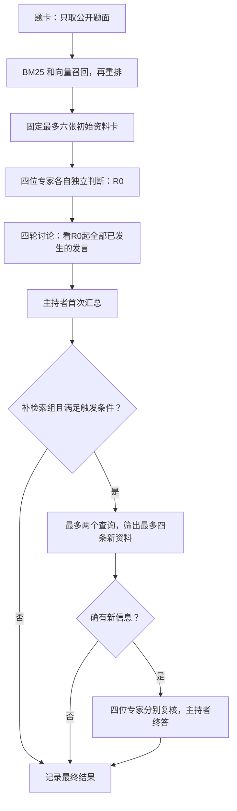

# 代码阅读顺序

准备新题的材料，先看 `src/preparation/`：`__main__.py` 提供命令入口；`selection.py` 显式抽题和排除旧题；`batch.py` 先共用检索、再依次准备 B/C/D 并保存汇总报告；`audit.py` 离线验收整批或单模式材料。单模式从 `__init__.py` 的 `prepare()` 主流程进入；`corpus.py` 准备真实文献和检索快照，`materials.py` 准备 B/C/D 干预材料，`state.py` 保存缓存与进度，`reuse.py` 复用同一批题已冻结的真实材料，`prompts.py` 集中存放准备提示词。换题只换输入文件和输出目录，不再写一份批次脚本；`data/` 和 `runs/` 中旧测试驱动只保留作历史记录。以下文件位于 `src/evidence_mdt/`，负责通用能力与正式实验。

B 的准备分两步：`prompts.B_ANNOTATE` 在一次调用中逐条判断全部冻结初始证据支持哪个选项，`materials.py` 保存标注，从非 null 证据中等概率随机抽一条（全 null 才从全部证据中抽）；随后 `prompts.B` 只负责所选原文的10份完整改写，不做语义 check。`interventions.py` 共用常量设定目标共11次（原始一次＋追加10份），默认条件为 base/literal11/paraphrase11，10条初始证据追加后为20条。规格保存 `b_evidence_annotations`、`b_target_candidate_ids`、`b_target_selection` 和固定目标，断点恢复不会换目标；`audit.py` 按种子复算并核对抽取结果，并按准备配置记录的 `b_conditions` 检查副本数量。旧批次保留原抽样与次数记录。

D 先随机固定一个非金标选项，再由 `prompts.D` 一次统筹生成机制、表现/人群、检查解读、鉴别比较、病程/反应五个角度的错误证据。`d_evidence_passages` 直接保存模型返回的段落和说明，`d_evidence()` 按原顺序追加正文。`intervention_preflight.py` 关联各段编号和审计说明，CLI 把正文构成的 Evidence 传入 Runner，并将 `d_evidence_audit` 写入实验结果。

1. `schema.py`：题目、证据、专家发言与预算的数据结构；`Question.public()` 只给模型可见字段。
2. `data.py`：题目规范化、本地文本和 PubMed 快照；旧 `prepare_pilot()` 只用于历史流程，新准备入口不自动抽题。
3. `retrieval.py`：来源过滤、BM25、MedCPT 向量召回、RRF 与重排。`Retriever.search()` 在排名前处理 `exclude`，供补检索使用。
4. `models.py`：模型 API 适配和仅供测试的 `MockModel`。实际请求、模型返回和用量写入调用日志。
5. `runner.py`：四专家独立 R0、四轮顺序可见讨论、主持者汇总、条件补检索、断点记录。
6. `interventions.py`：B 的重复片段、C 的公开错误消息与 D 的错误证据注入，人工生成谱系不传给模型。
7. `metrics.py`：统计正确率、共同错误、失败率和配对差异；历史 `brier` 字段为原始数值平方误差，不保证标准概率校准解释。
8. `cli.py`：`prepare`、`index`、`run`、`evaluate` 命令，以及运行指纹和完整分配清单。
9. `run_batch.py`：读取已验收的批次材料，一次调度普通组的 B/C/D，共用基线，按题并行、续跑并汇总。`run_bc.py` 是默认选择 B/C 的兼容入口。

`intervention_preflight.py` 可以理解为“开跑前检查材料”：检查全部输入 MedXpertQA 题的目标片段、转述文本、C 错误消息或 D 错误证据配置是否齐全，不再抽取固定子集。`budget_resume.py` 只管理调用额度和接续校验；提高额度不会自动允许更换题目、模型或实验方法。

建议先运行 `python -m pytest -q`。测试中的合成题与 mock 模型只验证程序行为，不验证医学正确性。真实检索要用 MedCPT 后端和可核验的 PubMed／PMC／本地合法语料；真实协作还要有模型 API 密钥。

## 一道题怎样走完程序

可以把 `Question` 想成一张题卡，把 `Evidence` 想成检索到的资料卡。题卡内部保存标准答案，方便最后评分；真正发给模型时只使用 `Question.public()`，标准答案不会进入提示词。



读 `runner.py` 时，先找 `run_group()` 看这个主流程，再读 `_turn()` 看一次发言怎样校验和保存。最后读 `message_view()`：普通组保留各条命题，语义组将含义等价的命题合成一条。原始发言一直保存在日志里，合并只改变后续专家实际看到的材料。

## 几个容易混淆的词

- **命题（Claim）**：一句可以单独判断的依据，例如“某检查支持某选项”。适用条件和反对理由也要写清楚，不能只记录最终选项。
- **语义簇**：程序认为表达同一条信息的一组命题。来自不同论文也可能合并；这不证明这些论文真的使用了同一个原始研究。
- **暴露（exposed）**：某位专家当时看得到一条资料或意见。看得到不代表一定受它影响。
- **引用（cited）**：模型在 `citations` 或 `claims[].citation_ids` 中填写的 ID。v2.10 起不再按逐次清单筛选引用；提示词要求使用所提供证据与全部历史里的编号、不编造编号。引用记录本身不证明 ID 已成功解析，也不证明医学依据正确；原始输入和图谱供离线追溯。
- **R0 回放**：同一道题、同一次重复运行的各方法共享最初四位专家意见，便于公平比较。第二次独立运行仍要重新调用模型，不能把回放算成第二次。
- **attempt_id**：一次执行尝试的编号。失败后重新执行会有新编号，用来防止把两次尝试的发言接成一张错误的图。

## 从哪里看结果

先读项目根目录的 `PROGRESS.md` 了解执行到哪一步。每批运行的中文技术摘要可以这样生成：

```powershell
$py = 'C:\Users\Administrator\miniconda3\envs\med-consensus\python.exe'
& $py scripts/summarize_smoke.py runs/deepseek_smoke_oct09_v2 --preparation-manifest data/smoke/preparation_manifest.json
```

然后打开该目录的 `smoke_acceptance.md`。如果某次失败，先查 `failures.jsonl` 中的原因，再按 `run_id` 到 `calls.jsonl` 找原始返回。程序不会把缺失概率补成看似合理的数值；格式修复也要保留已经合法的概率和所选答案。

`scripts/audit_run.py` 检查讨论顺序、概率和图边能否对上记录；`scripts/analyze_common_errors.py` 寻找四专家与主持者共同答错的案例，并沿明确引用追溯资料。它不能从“看过一条消息”推断“被这条消息说服”。旧发言只能引用当时已经存在的簇版本，不能用后来新增的成员倒推过去的依据。

`scripts/check_difficulty.py` 只在原定 30 道 MedQA、每题两次的 60 个结果齐全且校验通过后，计算是否达到 54/60 的切换门槛。未完成时返回 `pending`，不会因为暂时全部答对就提前换题。
