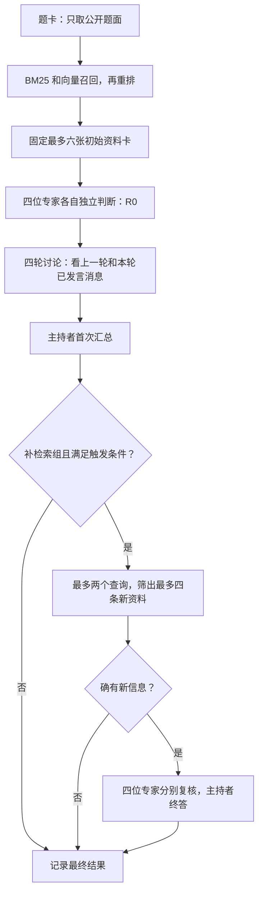

# 代码阅读顺序

1. `schema.py`：题目、证据、专家发言与预算的数据结构；`Question.public()` 只给模型可见字段。
2. `data.py`：下载与固定抽样、题目规范化、本地文本和 PubMed 快照。读 `prepare_pilot()` 可看到抽样框如何定义。
3. `retrieval.py`：来源过滤、BM25、MedCPT 向量召回、RRF 与重排。`Retriever.search()` 在排名前处理 `exclude`，供补检索使用。
4. `models.py`：模型 API 适配和仅供测试的 `MockModel`。实际请求、模型返回和用量写入调用日志。
5. `runner.py`：四专家独立 R0、四轮顺序可见讨论、主持者汇总、条件补检索、断点记录。
6. `interventions.py`：B 的重复片段与 C 的错误消息／证据扰动，人工生成谱系不传给模型。
7. `metrics.py`：按数据集统计 Brier、正确率、共同错误、失败率和配对差异。
8. `cli.py`：`prepare`、`index`、`run`、`evaluate` 命令，以及运行指纹和完整分配清单。

新增的 `intervention_preflight.py` 可以理解为“开跑前检查材料”：先抽出 B/C 共用的 25 题，检查目标片段、转述文本和错误消息配置是否齐全，再允许调用模型。`budget_resume.py` 只管理调用额度和接续校验；提高额度不会自动允许更换题目、模型或实验方法。

建议先运行 `python -m pytest -q`。测试中的合成题与 mock 模型只验证程序行为，不验证医学正确性。真实检索要用 MedCPT 后端和可核验的 PubMed／PMC／本地合法语料；真实协作还要有模型 API 密钥。

## 一道题怎样走完程序

可以把 `Question` 想成一张题卡，把 `Evidence` 想成检索到的资料卡。题卡内部保存标准答案，方便最后评分；真正发给模型时只使用 `Question.public()`，标准答案不会进入提示词。



读 `runner.py` 时，先找 `run_group()` 看这个主流程，再读 `_turn()` 看一次发言怎样校验和保存。最后读 `message_view()`：普通组保留各条命题，语义组将含义等价的命题合成一条。原始发言一直保存在日志里，合并只改变后续专家实际看到的材料。

## 几个容易混淆的词

- **命题（Claim）**：一句可以单独判断的依据，例如“某检查支持某选项”。适用条件和反对理由也要写清楚，不能只记录最终选项。
- **语义簇**：程序认为表达同一条信息的一组命题。来自不同论文也可能合并；这不证明这些论文真的使用了同一个原始研究。
- **暴露（exposed）**：某位专家当时看得到一条资料或意见。看得到不代表一定受它影响。
- **引用（cited）**：模型明确填写了某条可见材料的编号。它比“看得到”更具体，但仍不等于医学依据一定正确。
- **R0 回放**：同一道题、同一次重复运行的各方法共享最初四位专家意见，便于公平比较。第二次独立运行仍要重新调用模型，不能把回放算成第二次。
- **attempt_id**：一次执行尝试的编号。失败后重新执行会有新编号，用来防止把两次尝试的发言接成一张错误的图。

## 从哪里看结果

先读项目根目录的 `PROGRESS.md` 了解执行到哪一步。每批运行的中文技术摘要可以这样生成：

```powershell
$py = 'C:\Users\Administrator\miniconda3\envs\med-consensus\python.exe'
& $py scripts/summarize_smoke.py runs/deepseek_smoke_oct09_v2 --preparation-manifest data/smoke/preparation_manifest.json
```

然后打开该目录的 `smoke_acceptance.md`。如果某次失败，先查 `failures.jsonl` 中的原因，再按 `run_id` 到 `calls.jsonl` 找原始返回。程序不会把缺失概率补成看似合理的数值；格式修复也要保留已经合法的概率和所选答案。

`scripts/audit_run.py` 检查讨论顺序、概率和图边能否对上记录；`scripts/analyze_common_errors.py` 寻找四专家与主持者共同答错的案例，并沿明确引用追溯资料。它不能从“看过一条消息”推断“被这条消息说服”。旧发言只能引用当时已经存在的簇版本，不能用后来新增的成员倒推过去的依据。

`scripts/check_difficulty.py` 只在原定 30 道 MedQA、每题两次的 60 个结果齐全且校验通过后，计算是否达到 54/60 的切换门槛。未完成时返回 `pending`，不会因为暂时全部答对就提前换题。
